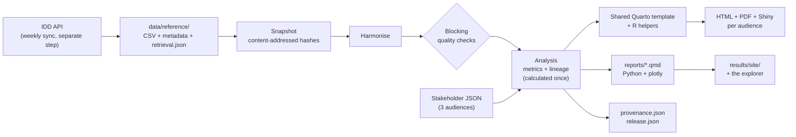

# Reproducible infectious-disease reports

One open Swiss data source, three audiences, one command. This project turns the Federal Office of Public Health (FOPH) [Infectious Diseases Dashboard](https://www.idd.bag.admin.ch/) exports into interactive HTML reports for researchers, health institutions and the public. All three come from a single shared Quarto template and differ only by audience parameter files. Every report carries machine-readable provenance, and uncertainty and limitations are shown to every audience, translated rather than hidden.

Built for the hackathon challenge *One Data Source, Many Audiences: reproducible, parameterised communication of life-science data*.

## Quick start

One entry point, the same on Windows, Linux and macOS. It needs
[uv](https://docs.astral.sh/uv/getting-started/installation/) and
[Quarto](https://quarto.org/docs/get-started/), and nothing else: `uv` creates the single
Python environment and fetches Python 3.11 itself. There is no setup step.

```sh
python run.py              # build the reports (nothing opens; add --open)
python run.py web          # explore the data and build a report for chosen diseases
python run.py test         # run the test suite
python run.py release      # all three audiences, with PDFs and Shiny apps (needs Docker)
python run.py clean        # delete everything the build produced
```

The build reads the committed data in `data/reference/`. It fetches no new IDD data and
needs no GitHub account, token or Actions run. Step-by-step instructions, including what
each screen does and what to do when something fails, are in
[HOW_TO_RUN.md](HOW_TO_RUN.md).

### The full three-audience release

`python run.py release` also produces PDFs and Shiny apps, which need R and TeX on top of
the above. One image, built from `Dockerfile`, carries Python, R, Quarto and TinyTeX:

```sh
export LOCAL_UID="$(id -u)"
export LOCAL_GID="$(id -g)"
docker compose build report
docker compose run --rm report snakemake --cores 2
```

Runtime versions are declared in `workflow/toolchain.json`. Verify a completed release:

```sh
docker compose run --rm report python backend/check_outputs.py
docker compose run --rm report python backend/verify_release.py --out results
```

## What you get

Three audience releases, from one shared template and one set of verified tables:

| Audience | Report | Style |
|---|---|---|
| Researchers (`researcher`) | `results/reports/researcher/report.html` | Technical: parameters and filters, coverage, quality checks, methods, reproduction code |
| Health institutions (`health_institution`) | `results/reports/health_institution/report.html` | Monitoring: largest changes in case counts, small-number flags, quality summary |
| Public (`public`) | `results/reports/public/report.html` | Plain language: "How sure can we be?", readable provenance |

Each folder also holds `methods.html`, PDFs, `provenance.json` (also embedded in each HTML page), the analysis tables in `data/`, and a Shiny app. `results/release.json` records artifact hashes, code hashes, Git state and runtime versions.

To add an audience, copy a file in `backend/config/stakeholders/`, change its `id`, wording, sections and presentation, and list the id in `workflow/config.yaml`. The template does not change.

### Standalone Quarto reports

`python run.py` builds two self-contained reports with a landing page, from the same
harmonised table and behind the same quality gate:

| Report | Output | Reads |
|---|---|---|
| Public health officials (`public_health`) | `results/site/public_health.html` | What needs attention now, and where |
| Researchers (`researcher`) | `results/site/researcher.html` | How it was measured, and can it be reproduced |

Open `results/site/index.html` to choose between them. Each embeds its own
`provenance_<report>.json`, and both read the same cleaned table, so their numbers agree.

These reports are Python only (`jupyter: python3`, pandas and plotly); unlike the audience
releases above they need no R, Shiny or TeX, and they add canton-level incidence and
seasonality that the national-totals releases do not carry.

The source is `reports/<name>.qmd` plus the shared `reports/shared/helpers.py` and
`reports/shared/provenance.py`; the HTML under `results/site/` is a build artifact, never
edited by hand. Add a report by adding `reports/<name>.qmd` and listing `<name>` under
`quarto_reports` in `workflow/config.yaml`; an empty list disables this path.

### The explorer

`python run.py web` serves a local page on <http://127.0.0.1:2718> that reads the same
analysis bundles:

- pick an audience and see the dashboards its report is built from — the charts are drawn
  by the reports' own plotting code, so they are the same figures, not a second version;
- tick the diseases you care about and generate a report for exactly those, rendered here
  with Quarto in roughly 20–60 seconds, or instantly if that selection was built before;
- read any report in the page, with its provenance record underneath.

Which panels an audience sees follows the `outputs` list in its stakeholder file. The page
loads nothing from the internet and sends nothing anywhere.

## How it works



Statistics are calculated once in Python; every format, audience and dashboard only presents the verified tables.

## Repository layout

| Path | What |
|---|---|
| `run.py` | The single entry point for every task above |
| `Snakefile`, `workflow/` | The workflow, its rules and its configuration |
| `backend/` | The Python pipeline: snapshot, harmonise, check, analyse, render, release |
| `reports/` | Report sources: `<name>.qmd` plus `shared/` helpers and `assets/` |
| `frontend/` | The explorer (`web/`), local rendering (`local_build.py`) and the optional Marimo interface |
| `data/reference/` | The committed source-data snapshot, one folder per dataset |
| `results/` | Everything the build produces (git-ignored) |

## Data source and version

FOPH Infectious Diseases Dashboard exports from the public API (`https://api.idd.bag.admin.ch/api/v1/export/latest/<DATASET>/csv`), committed under `data/reference/` with a `retrieval.json` per dataset (source URL, retrieval time, SHA-256). The publisher updates weekly on Wednesdays. Each report's provenance names the snapshot id, publisher release dates and retrieval dates it used. The FOPH states the data are publicly accessible and may be used with proper source attribution; please attribute **Federal Office of Public Health (FOPH/BAG), Infectious Diseases Dashboard**. See [data/README.md](data/README.md).

## Read this before using the numbers

The reports describe officially notified cases, not all infections. They are descriptive comparisons with a reference year, not tests of significance or causal claims. The three audience releases use national totals only (Switzerland plus Liechtenstein), with no canton-level or seasonal analysis. The standalone Quarto reports add canton-level incidence, seasonality, and a weekly respiratory season watch that labels each indicator against its own historical comparison window; those levels are descriptive cues, as the reports state, not significance tests or a risk classification, and no outbreak-detection method is applied on either path. The viral increase versus 2019 (+124%) turns into −3% when influenza is excluded.

## Documentation

| Topic | Document |
|---|---|
| How to run everything, step by step | [HOW_TO_RUN.md](HOW_TO_RUN.md) |
| Data contract and schema | [SCHEMA.md](backend/SCHEMA.md) |
| Source data, terms, retired legacy root | [data/README.md](data/README.md) |
| Optional Marimo interface and GitHub Actions | [CONNECTOR_SETUP.md](CONNECTOR_SETUP.md) |
| Release notes | [RELEASE_NOTES.md](RELEASE_NOTES.md) |
| Contributing | [CONTRIBUTING.md](CONTRIBUTING.md) |

Citing this work: see [CITATION.cff](CITATION.cff).

## Tests and release discipline

```sh
python run.py test
# or, directly
ruff check .
python -m pytest -q
snakemake --dry-run --cores 1
# after a full build
python backend/check_outputs.py
python backend/verify_release.py --out results
Rscript tests/shiny_smoke.R results/reports/researcher/app
```

Tests cover subgroup safety, incomplete months/years/baselines, denominators, source completeness, metadata conflicts, overlapping exports, nonzero CLI failures, stale gates, snapshot relocation/tampering, deterministic tables, and independent reconstruction of every fixture metric from raw records and formula inputs. The final dry run should say no work is needed after a successful unchanged build.

CI is split into gated jobs: `fast` (Ruff, tests, dry run), `secrets` (pinned gitleaks history scan), `container` (report-image build, all-audience rendering, provenance/release verification, app smoke tests and no-op rebuild) and `full` (all three audiences, output and provenance checks, release-hash and rendered-link verification, Shiny checks, no-op rebuild). It uploads a release bundle only after every `full` step succeeds. It does not deploy or overwrite a production site. A failed local build may leave older reports on disk; treat only a successfully completed build and its matching `release.json` as a release. Preserve previously uploaded successful artifacts independently of a new build.

`pyproject.toml` and `uv.lock` declare and pin the single Python environment that runs the pipeline, the reports and the explorer; `requirements.txt` is exported from that same resolution for pip users and the container build; `renv.lock` records the R dependencies used by the audience releases. `workflow/toolchain.json` is the machine-readable source of runtime version policy.
